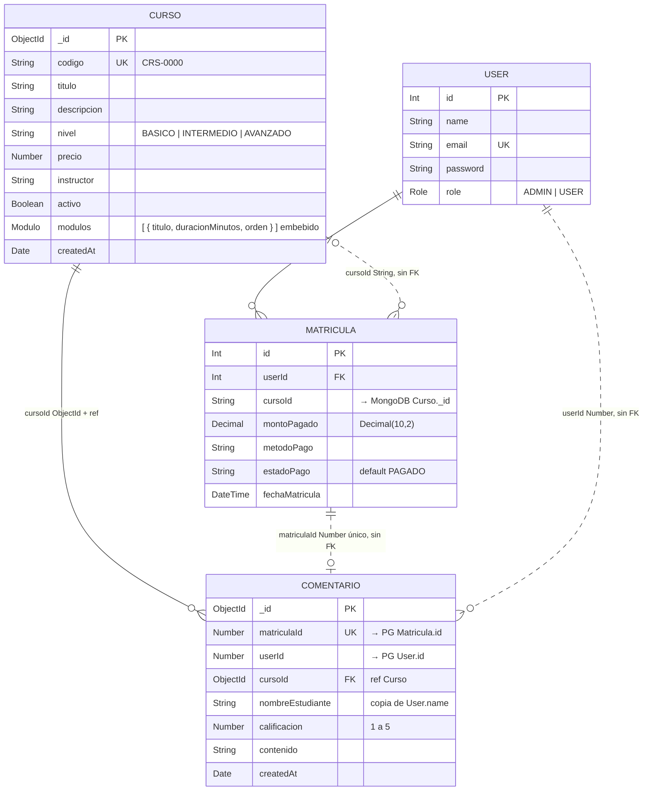
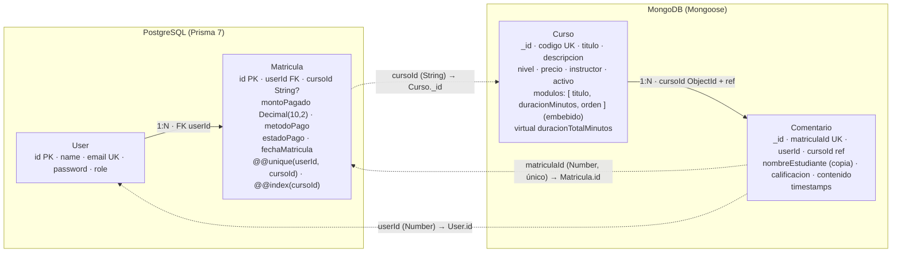

# Tarea individual U2 · Modelo híbrido PostgreSQL + MongoDB

**Estudiante:** Isaac Maisincho  **N.º de lista:** 8 **Caso:** 8 · Cursos en línea

> **Pista del workload (Caso 8):** *la matrícula no se duplica; los módulos se leen junto con el curso.*

## 1. Workload

### 1.1 Casos de uso

- Una plataforma de cursos en línea ofrece un catálogo de cursos; cada curso tiene un nivel (BÁSICO, INTERMEDIO o AVANZADO), un precio, un instructor y una lista ordenada de módulos con su duración.
- Los estudiantes (y visitantes sin cuenta) buscan cursos por texto, nivel o precio y ven el detalle del curso **con todos sus módulos** en una sola pantalla.
- El estudiante se matricula y paga un curso. **No puede matricularse dos veces en el mismo curso.**
- El estudiante ve "Mis cursos": sus matrículas con el código, título, nivel e instructor de cada curso.
- Después de cursar, el estudiante deja **un comentario por matrícula** (calificación de 1 a 5 y texto).
- Cualquier visitante lee los comentarios de los cursos y el promedio de calificación por curso.
- El administrador crea, edita y retira cursos del catálogo. Un curso con matrículas no se puede borrar.

### 1.2 Datos principales (cuántos actores, cuántos registros, cuánto tiempo se guardan)

- Estudiantes: ~5 000 (crecen ~200 por mes). Administradores/instructores: ~10.
- Cursos en el catálogo: ~60, con 5 a 20 módulos cada uno (crecen ~2 por mes).
- Matrículas: ~120 por día (~3 600 por mes). Una por estudiante y curso.
- Comentarios: ~40 por día (un tercio de las matrículas). **Crecen sin límite:** ~14 600 por año.
- Período: matrículas y comentarios se guardan 5 años (historial académico y contable del pago).

### 1.3 Suposiciones (lo que puede cambiar)

- Un estudiante no se matricula dos veces en el mismo curso (integridad fuerte, la pista del caso).
- El pago y la matrícula se registran juntos: si falla uno, no queda ninguno (atomicidad).
- Una matrícula tiene como máximo **un** comentario.
- El nombre del estudiante casi nunca cambia: se puede copiar en el comentario.
- Los módulos de un curso son pocos (decenas como máximo), se editan con el curso y **siempre se muestran con él**.
- Cada curso puede tener campos distintos en el futuro (requisitos, certificados, enlaces de video), por eso el catálogo es flexible.
- Los comentarios se muestran del más nuevo al más antiguo y con el promedio por curso.

### 1.4 Operaciones

Resumen (8 operaciones):

| # | Actor | Operación | Lectura / Escritura | Frecuencia estimada | Datos involucrados | Base |
|---|---|---|---|---|---|---|
| 1 | Visitante / Estudiante | Buscar y listar cursos (`?q=`, `?fields=`, `?sort=`) | Lectura | ~8 000 / día | codigo, titulo, nivel, precio, instructor | MongoDB |
| 2 | Visitante / Estudiante | Ver el detalle de un curso con sus módulos | Lectura | ~5 000 / día | curso completo + modulos[] + duración total | MongoDB |
| 3 | Estudiante | Matricularse y pagar un curso | Escritura | ~120 / día (picos al abrir inscripciones) | userId (JWT), cursoId, montoPagado, metodoPago | PostgreSQL (valida cursoId en MongoDB) |
| 4 | Estudiante | Ver "Mis cursos" con los datos del curso | Lectura | ~2 500 / día | matrícula (PG) + codigo, titulo, nivel, precio, instructor (Mongo) | Las dos |
| 5 | Estudiante | Comentar y calificar su matrícula | Escritura | ~40 / día | matriculaId, calificacion, contenido; userId (JWT); nombreEstudiante copiado | MongoDB (valida la matrícula en PG) |
| 6 | Visitante | Leer comentarios y el promedio por curso | Lectura | ~3 000 / día | nombreEstudiante, calificacion, contenido, createdAt; promedio y total | MongoDB |
| 7 | Administrador | Crear o editar un curso | Escritura | ~10 / mes | todos los campos del curso y sus módulos | MongoDB |
| 8 | Administrador | Eliminar un curso | Escritura | ~2 / año | _id; conteo de matrículas en PG; comentarios del curso | MongoDB, revisando PostgreSQL |

Detalle por operación:

| Actor: | Visitante / Estudiante |
|---|---|
| Descripción: | Busca cursos por texto en título o instructor, elige qué campos ver y ordena por precio o fecha |
| Tipo de operación: | Lectura |
| Datos en la operación: | codigo, titulo, nivel, precio, instructor (proyección dinámica `?fields=`) |
| Frecuencia: | en cada visita a la página del catálogo |
| Tasa: | ~8 000 / día |
| Base: | **MongoDB** (documento listo para mostrar, búsqueda con `$regex` insensible a mayúsculas) |

| Actor: | Visitante / Estudiante |
|---|---|
| Descripción: | Abre el detalle de un curso y ve todos sus módulos en orden con la duración total |
| Tipo de operación: | Lectura |
| Datos en la operación: | curso completo + `modulos[]` (titulo, duracionMinutos, orden) + virtual `duracionTotalMinutos` |
| Frecuencia: | al hacer clic en un curso |
| Tasa: | ~5 000 / día |
| Base: | **MongoDB**: una sola lectura porque los módulos están embebidos |

| Actor: | Estudiante |
|---|---|
| Descripción: | Se matricula y paga un curso |
| Tipo de operación: | Escritura |
| Datos en la operación: | userId (del JWT), cursoId, montoPagado, metodoPago, estadoPago, fechaMatricula |
| Frecuencia: | ~120 por día, con picos al abrir inscripciones |
| Tasa: | 120 / día |
| Base: | **PostgreSQL** (transacción ACID y `@@unique([userId, cursoId])`); lee MongoDB con `Curso.exists` para validar `cursoId` |

| Actor: | Estudiante |
|---|---|
| Descripción: | Ve "Mis cursos": sus matrículas con el código, título, nivel, precio e instructor del curso |
| Tipo de operación: | Lectura |
| Datos en la operación: | matrículas (PostgreSQL) + codigo, titulo, nivel, precio, instructor (MongoDB) |
| Frecuencia: | cada estudiante activo, ~1 vez al día |
| Tasa: | ~2 500 / día |
| Base: | **Las dos**: se une en el servicio con `$in` y un `Map` (2 consultas en total, sin N+1) |

| Actor: | Estudiante |
|---|---|
| Descripción: | Comenta y califica el curso de una matrícula suya |
| Tipo de operación: | Escritura |
| Datos en la operación: | matriculaId, calificacion, contenido; userId del JWT; cursoId y nombreEstudiante copiados de PostgreSQL |
| Frecuencia: | un tercio de las matrículas |
| Tasa: | ~40 / día (sin límite en el tiempo: ~73 000 en 5 años) |
| Base: | **MongoDB**, colección aparte; lee PostgreSQL para validar que la matrícula exista y sea del usuario |

| Actor: | Visitante |
|---|---|
| Descripción: | Lee los comentarios (con el curso poblado) y el promedio de calificación por curso |
| Tipo de operación: | Lectura |
| Datos en la operación: | nombreEstudiante, calificacion, contenido, createdAt; `populate` del curso; `aggregate` con promedio y total |
| Frecuencia: | al elegir un curso o ver el ranking |
| Tasa: | ~3 000 / día |
| Base: | **MongoDB** solamente (por eso se copia `nombreEstudiante`) |

| Actor: | Administrador |
|---|---|
| Descripción: | Crea o edita un curso con sus módulos |
| Tipo de operación: | Escritura |
| Datos en la operación: | todos los campos del curso y `modulos[]` |
| Frecuencia: | pocas veces al mes |
| Tasa: | ~10 / mes |
| Base: | **MongoDB** (`findById` + `save()` para que corran las validaciones y el `pre("validate")`) |

| Actor: | Administrador |
|---|---|
| Descripción: | Elimina un curso del catálogo |
| Tipo de operación: | Escritura |
| Datos en la operación: | _id; conteo de matrículas que lo usan; comentarios del curso |
| Frecuencia: | casi nunca |
| Tasa: | ~2 / año |
| Base: | **MongoDB**, revisando PostgreSQL (409 si hay matrículas; si no, borra el curso y sus comentarios en cascada) |

### 1.5 Entidades

- **PostgreSQL**
  - User
    - Matricula (1:N, FK `userId`)
- **MongoDB**
  - Curso
    - modulos[] (embebido)
    - Comentario (1:N, `cursoId` ObjectId + `ref: 'Curso'`)
- **Entre bases (sin FK)**
  - Matricula.cursoId → Curso._id (String de 24 caracteres)
  - Comentario.matriculaId → Matricula.id (Number, único)
  - Comentario.userId → User.id (Number) · Comentario.nombreEstudiante (copia de User.name)

### 1.6 Observaciones (qué domina: lectura o escritura, qué crece sin límite, qué necesita integridad)

- Hay **~100 lecturas por cada escritura** (~18 500 lecturas frente a ~160 escrituras al día): lo que más se lee (catálogo, detalle del curso, comentarios) debe salir de una sola consulta.
- Lo único que crece sin límite son los comentarios: van en su propia colección, nunca embebidos en el curso (límite de 16 MB por documento).
- La matrícula necesita integridad y atomicidad (no duplicarse, pago registrado junto con la matrícula): se queda en PostgreSQL con `@@unique([userId, cursoId])`.
- Los módulos son pocos, acotados y siempre se leen con el curso: se embeben (pista del caso).
- Índices que pide el workload: `Matricula @@index([cursoId])` y `@@unique([userId, cursoId])` (PostgreSQL); `cursos.codigo` único, `comentarios.matriculaId` único y `comentarios { cursoId: 1, createdAt: -1 }` (MongoDB).

## 2. ¿PostgreSQL o MongoDB?

| Entidad | ¿Transacciones o choques? | ¿Otras dependen por FK? | ¿Forma variable? | ¿Crece sin límite? | ¿Se lee mucho más? | Base |
|---|---|---|---|---|---|---|
| User | Sí: email único, registro y login | Sí: Matricula depende de User por FK | No: forma fija (nombre, email, contraseña, rol) | No: crece despacio (~200/mes) | Sí (login), pero con pocas escrituras | **PostgreSQL** |
| Matricula | **Sí**: pago + matrícula atómicos; dos peticiones a la vez no pueden crear la misma matrícula | Sí: depende de User por FK y la referencian los comentarios | No: siempre los mismos campos | Moderado (~3 600/mes), acotado por estudiantes × cursos | Se lee y se escribe parecido | **PostgreSQL** |
| Curso | No: lo edita un administrador, pocas veces | No por FK (lo referencian desde PG sin FK) | **Sí**: cada curso puede tener campos y módulos distintos | No: ~60 cursos | **Sí**: ~13 000 lecturas/día frente a ~10 escrituras/mes | **MongoDB** |
| Comentario | No: un solo escritor por matrícula; el único choque se resuelve con índice único | No | Algo (puede sumar etiquetas, respuestas, adjuntos) | **Sí**: sin límite en el tiempo | **Sí**: ~3 000 lecturas/día frente a ~40 escrituras | **MongoDB** |

Respuestas explícitas a las 5 preguntas por entidad:

**User**
1. *¿Necesita transacciones ACID?* Sí en el alta: el email debe ser único y la contraseña se guarda junto con el rol en un solo paso.
2. *¿Otras entidades dependen de ella por clave foránea?* Sí: `Matricula.userId` es FK hacia `User.id`; la integridad referencial la garantiza PostgreSQL.
3. *¿Tiene esquema o forma variable?* No: siempre nombre, email, contraseña y rol.
4. *¿Cuál es su tasa de crecimiento?* Baja y acotada (~200 usuarios por mes).
5. *¿Proporción lectura vs. escritura?* Se lee en cada login (~5 000/día) y se escribe solo al registrarse; las lecturas son por clave única (email), que PostgreSQL resuelve bien.
→ **PostgreSQL.**

**Matricula**
1. *¿Necesita transacciones ACID?* **Sí**: la matrícula y su pago se registran juntos, y si dos peticiones llegan a la vez solo una puede crear la matrícula (`@@unique([userId, cursoId])` → `P2002` → 409).
2. *¿Otras dependen de ella por FK?* Depende de `User` por FK, y `Comentario.matriculaId` la referencia (validada en el servicio).
3. *¿Forma variable?* No: userId, cursoId, monto, método, estado y fecha son fijos.
4. *¿Tasa de crecimiento?* ~120 por día, acotada por (estudiantes × cursos).
5. *¿Lectura vs. escritura?* Equilibrada (~2 500 lecturas de "Mis cursos" frente a ~120 escrituras), y lo crítico es la escritura correcta.
→ **PostgreSQL.**

**Curso**
1. *¿Necesita transacciones ACID?* No: lo edita un solo administrador y cada cambio afecta a un único documento (MongoDB ya es atómico a nivel de documento).
2. *¿Otras dependen de ella por FK?* No hay FK: `Matricula.cursoId` y `Comentario.cursoId` la referencian, pero la existencia la valida el servicio (`Curso.exists`) y el borrado se protege con un conteo en PostgreSQL.
3. *¿Forma variable?* **Sí**: cada curso tiene su propia lista de módulos y puede sumar campos (requisitos, certificado, enlaces).
4. *¿Tasa de crecimiento?* Muy baja (~2 cursos por mes).
5. *¿Lectura vs. escritura?* **Muchísimo más lectura** (~13 000 lecturas/día frente a ~10 escrituras/mes): conviene un documento listo para mostrar.
→ **MongoDB.**

**Comentario**
1. *¿Necesita transacciones ACID?* No: se inserta un documento; el único choque posible (dos comentarios para la misma matrícula) lo resuelve el índice único `matriculaId` (`E11000` → 409).
2. *¿Otras dependen de ella por FK?* No: nadie referencia a un comentario.
3. *¿Forma variable?* Puede crecer en forma (etiquetas, respuestas del instructor, adjuntos) sin migraciones.
4. *¿Tasa de crecimiento?* **Sin límite** en el tiempo (~14 600 por año).
5. *¿Lectura vs. escritura?* Se lee ~75 veces más de lo que se escribe; la lista y el promedio salen de MongoDB sin tocar PostgreSQL.
→ **MongoDB.**

## 3. Relaciones dentro de MongoDB: embeber o referenciar

| Relación | Cardinalidad | ¿Se lee junto? | ¿Cambia seguido? | ¿Crece sin límite? | Decisión |
|---|---|---|---|---|---|
| Curso → modulos | 1:N pocos (5 a 20) | **Sí**, siempre: el detalle del curso muestra sus módulos | No: cambian con el curso, pocas veces al mes | No: acotado | **Embeber** `modulos: [{ titulo, duracionMinutos, orden }]` |
| Curso → Comentario | 1:N muchos | No siempre: el catálogo no muestra comentarios; se leen aparte, paginados y con promedio | Sí: llegan comentarios nuevos cada día | **Sí** | **Referenciar**: colección `comentarios` con `cursoId` ObjectId + `ref: 'Curso'` (`populate`) |

Respuestas explícitas a las 3 preguntas:

**`modulos[]` dentro de `Curso` → embebido**
1. *Patrón de lectura:* cada vez que se abre un curso se muestran todos sus módulos en orden y la duración total (virtual `duracionTotalMinutos`). Embebidos, eso es **una sola lectura** sin `populate` ni `$lookup`. Es exactamente la pista del caso: "los módulos se leen junto con el curso".
2. *Patrón de escritura:* los módulos se crean y editan junto con el curso, por el mismo administrador, pocas veces al mes. Al guardar el curso con `save()` se validan los módulos (`required`, `min`) y el hook `pre("validate")` les asigna el `orden` que falte.
3. *¿Acceso junto o por partes?* **Junto**: nunca se consulta un módulo sin su curso, y la lista es pequeña y acotada, así que no hay riesgo de llegar al límite de 16 MB.

**`Comentario` → colección referenciada**
1. *Patrón de lectura:* los comentarios se leen por separado (lista general o de un curso, del más nuevo al más antiguo) y en agregados (`$group` con `$avg` y `$sum`). El catálogo, que es lo más leído, no los necesita; embeberlos haría pesada cada lectura del curso.
2. *Patrón de escritura:* llegan ~40 comentarios nuevos por día, cada uno escrito por un estudiante distinto. En una colección aparte cada comentario es una inserción independiente; embebidos, cada uno reescribiría el documento del curso y competiría con las ediciones del administrador.
3. *¿Acceso junto o por partes?* **Por partes**: se crean de a uno, se listan con filtros y se resumen con `aggregate`. Además crecen sin límite, así que embebidos acabarían superando el límite de 16 MB del documento del curso. Se referencian con `cursoId` (ObjectId + `ref`) para poder hacer `populate('cursoId', 'codigo titulo nivel')`.

## 4. ERD híbrido (notación pata de gallo, como el material 2.1)

Línea continua: FK de PostgreSQL o `ref` de Mongoose. **Línea punteada: referencia entre bases** (sin FK).

Vista por zonas (dos subgrafos, flechas punteadas `-.->` para las referencias entre bases):

## 5. Referencias

| Referencia | Se guarda como | La garantiza | Se une con |
|---|---|---|---|
| `Matricula.userId` → `User.id` | `Int` con FK en PostgreSQL | **PostgreSQL** (FK, integridad referencial) | `include: { user: true }` en Prisma |
| `Matricula.cursoId` → `Curso._id` | `String?` (24 caracteres hex del ObjectId), con `@@index([cursoId])` | **Servicio**: `mongoose.isValidObjectId` (400) + `Curso.exists({ _id })` (404) al matricular; el borrado del curso revisa `prisma.matricula.count` (409) | `GET /api/matriculas`: 1 consulta Prisma + 1 `Curso.find({ _id: { $in } })` + `Map` por `_id.toString()` |
| `Comentario.matriculaId` → `Matricula.id` | `Number`, índice **único** en MongoDB | **Servicio**: `prisma.matricula.findUnique` (404 si no existe, 403 si no es del usuario); el índice único evita duplicados (`E11000` → 409) | Consulta a PostgreSQL por id antes de insertar el comentario |
| `Comentario.userId` → `User.id` | `Number` | **Token JWT**: sale de `req.user.id`, nunca del body; el servicio comprueba que coincide con el dueño de la matrícula | No se une: el nombre ya viene copiado en `nombreEstudiante` |
| `Comentario.cursoId` → `Curso._id` | `ObjectId` con `ref: 'Curso'` | **Servicio**: se copia desde `matricula.cursoId` (ya validada); el borrado del curso elimina sus comentarios en cascada (`Comentario.deleteMany`) | `.populate('cursoId', 'codigo titulo nivel')` y `$lookup` en el resumen |

## 6. Dato copiado entre bases (desnormalización)

- **Dato:** `nombreEstudiante` (copia de `User.name`, o del email si no hay nombre) y `cursoId` (copia de `Matricula.cursoId`) dentro de cada `Comentario`.
- **Por qué (operación del workload):** la lista de comentarios y el resumen por curso se leen ~3 000 veces al día. Con `nombreEstudiante` copiado, esa lectura sale **solo de MongoDB**, sin consultar PostgreSQL por cada comentario (evita el N+1 entre bases). Con `cursoId` copiado se puede hacer `populate`, filtrar por curso, agrupar con `$group` y borrar en cascada sin pasar por PostgreSQL.
- **Costo:** consistencia eventual. Si el estudiante cambia su nombre en PostgreSQL, sus comentarios viejos siguen mostrando el nombre anterior hasta que se ejecute una actualización masiva (`Comentario.updateMany({ userId }, { nombreEstudiante })`), que habría que disparar desde el servicio que edita el usuario. Se acepta porque el nombre casi nunca cambia y el comentario refleja quién escribió en ese momento. `cursoId` no tiene este costo: una matrícula nunca cambia de curso.

## 7. Endpoints

| Método y ruta | Base(s) | Respuestas posibles |
|---|---|---|
| `POST /api/auth/register` | PostgreSQL | 201, 400, 409 (email repetido) |
| `POST /api/auth/login` | PostgreSQL | 200 (token), 400, 401 |
| `GET /api/cursos?q=&fields=&sort=&nivel=` | MongoDB | 200 |
| `GET /api/cursos/:id` | MongoDB | 200, 400 (ObjectId inválido), 404 |
| `POST /api/cursos` (JWT) | MongoDB | 201, 400 (validación), 401, 409 (código repetido) |
| `PUT /api/cursos/:id` (JWT) | MongoDB (`findById` + `save()`) | 200, 400, 401, 404 |
| `DELETE /api/cursos/:id` (JWT) | MongoDB + PostgreSQL (conteo) | 200 (con `comentariosEliminados`), 400, 401, 404, 409 (tiene matrículas) |
| `POST /api/matriculas` (JWT) | PostgreSQL + MongoDB (`Curso.exists`) | 201, 400, 401, 404 (curso no existe), 409 (`P2002`: ya matriculado) |
| `GET /api/matriculas` (JWT) | PostgreSQL + MongoDB (`$in` + `Map`) | 200, 401 |
| `DELETE /api/matriculas/:id` (JWT) | PostgreSQL | 200, 400, 401, 403, 404 |
| `POST /api/comentarios` (JWT) | MongoDB + PostgreSQL (valida matrícula) | 201, 400, 401, 403 (matrícula ajena), 404, 409 (`E11000`: ya comentó) |
| `GET /api/comentarios?cursoId=` | MongoDB (`populate`) | 200, 400 |
| `GET /api/comentarios/resumen` | MongoDB (`aggregate`) | 200 |
